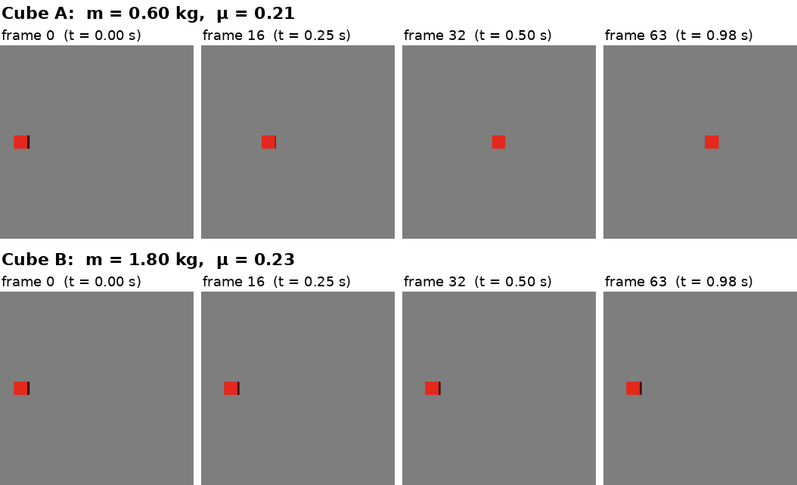
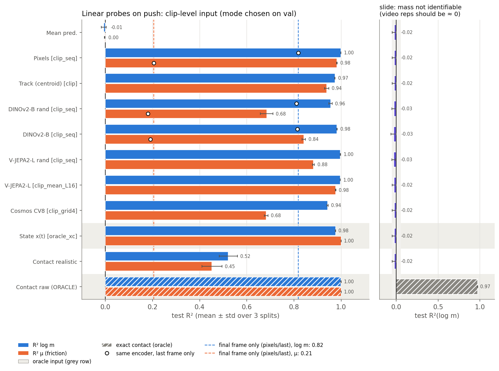

# physprobe: do frozen video encoders and a generative video tokenizer see hidden object physics?

A visually identical cube is pushed across a floor in MuJoCo with a fixed impulse. Its mass and friction never show in a single frame; they only change how it moves. We ask whether frozen video representations encode these hidden parameters linearly, and whether a touch signal adds to them. We probe V-JEPA 2 (a predictive self-supervised video model), DINOv2 (per-frame image features), random-weight copies of both, and the latent of a generative video tokenizer (NVIDIA Cosmos-Tokenize1). Every probe is compared against raw pixels, a colour tracker, the true trajectory and the floor contact forces, with identifiability controls.

Mikhail Sannikov, Ilya Mikhalchuk · October 2026 · release `v1.1`.



## Answer

Mass and friction are linearly decodable from frozen video features: V-JEPA 2 reaches test R² 0.997 for ln m and 0.977 for μ on 2000 push clips, and the controls show that the probe reads the cube's kinematics, not artefacts. Raw pixels do as well (0.999 / 0.982), so this clean scene does not rank encoders, as CALIPER [1] found. The Cosmos tokenizer latent is less linearly decodable at the poolings we tried (0.943 / 0.682; protocol-sensitive by up to ±0.07, see the write-up). A realistic touch signal reaches only 0.521 / 0.452 on its own, adds little on top of V-JEPA 2 (+0.005 for μ) and more on top of the weaker DINOv2 sequence (+0.11; protocol-sensitive by up to ±0.07, see the write-up). The only generative-model component probed is the Cosmos tokenizer's encoder; the diffusion denoiser was not probed.




### Results at a glance (push, test R² mean ± std over 3 splits; full tables in `results/push/table.md`)

| input | R²(ln m) | R²(μ) |
|---|---|---|
| raw pixels, 32×32 grey × 8 time bins | 0.999 ± 0.000 | 0.982 ± 0.002 |
| V-JEPA 2 ViT-L, block 16, mean-pooled (best by val) | 0.997 ± 0.000 | 0.977 ± 0.001 |
| V-JEPA 2 ViT-L, last layer, mean-pooled | 0.996 ± 0.000 | 0.970 ± 0.001 |
| V-JEPA 2 ViT-L, random weights, mean-pooled | 0.979 ± 0.011 | 0.850 ± 0.046 |
| DINOv2-B, 16-frame sequence | 0.983 ± 0.001 | 0.842 ± 0.007 |
| DINOv2-B, mean over frames | 0.838 ± 0.008 | 0.176 ± 0.060 |
| Cosmos CV8×8×8 tokenizer, 4×4 grid × 9 slots | 0.943 ± 0.002 | 0.682 ± 0.008 |
| realistic touch signal alone | 0.521 ± 0.038 | 0.452 ± 0.043 |
| true trajectory x(t) (reference; ceiling for μ only) | 0.976 ± 0.001 | 1.000 ± 0.000 |
| exact floor contact (oracle) | 1.000 ± 0.000 | 1.000 ± 0.000 |

Controls: every first-frame input scores ≈ 0 (the frame is identical across clips), and on the fixed-speed slide set every video input scores ≤ 0 for mass (no leak). V-JEPA 2 and DINOv2 keep the cube position under every pooling (R² 0.98–1.00 on the position check); Cosmos keeps it only in its 4×4 grid (0.986; global and spatial mean 0.16 / 0.17). All canonical CONTRACT v1.3 gates pass; two superseded plan-v1 rules, printed for information, fail as expected.

### Limitations and what is not done

- **One clean synthetic scene.** One untextured cube, a grey floor and a fixed camera, so the numbers show what is decodable in principle. Ranking encoders needs visual nuisances (CALIPER's result), which we did not test.
- **Mass only through the known impulse.** v₀ = J/m with J fixed, so "mass" is the initial speed.
- **Linear decodability, not use.** No MLP probe and no erasure test (cf. CALIPER's erasure analysis).
- **Generative leg is thin.** Only the Cosmos tokenizer's encoder is probed, pooled to 1×1 and 4×4 cells; the diffusion denoiser was not probed.
- **Small error bars by construction.** The 3 splits reshuffle one pool of clips and there is no bootstrap; PCA width and α grid move PCA-reduced rows by up to 0.12.

- Write-up with all claims, hypotheses, limitations and figures: [`docs/RESULTS_2026-10-22.md`](docs/RESULTS_2026-10-22.md).
- Full tables, every pooling mode, shuffled-label controls: [`results/push/table.md`](results/push/table.md), [`results/slide/table.md`](results/slide/table.md), [`results/poscheck/table.md`](results/poscheck/table.md).
- Sanity gates (mean predictor, static frame, permutation null, state reference, slide leak, position check): [`results/push/gates.md`](results/push/gates.md) and the same file per dataset.
- Features (1.5 GB) and the per-clip contact and state signals: Hugging Face dataset [`businesslion/physprobe-features`](https://huggingface.co/datasets/businesslion/physprobe-features), revision `v1.1`. With it the probe numbers reproduce on a CPU in about 15 minutes (see "Reproduce on a CPU").
- Slides (23-slide talk + appendix, HTML with speaker notes, and a PDF): attached to the [v1.1 release](https://github.com/msannikov03/physprobe/releases/tag/v1.1).
- Interface contract (data, feature and result formats; probe protocol): [`CONTRACT.md`](CONTRACT.md).
- Proposal, in Russian: [`docs/proposal_v2.md`](docs/proposal_v2.md).

## Demo

`notebooks/demo_two_cubes.ipynb` (executed, outputs embedded) takes the two cubes above, shows their frames, trajectories and contact forces, and runs the canonical ridge probe on three inputs. From the identical first frame the probe can only return the training mean; from the clip it recovers both masses; adding the realistic touch signal changes little.

| input | pred. m A (kg) | pred. μ A | pred. m B (kg) | pred. μ B |
|---|---|---|---|---|
| truth | 0.605 | 0.212 | 1.798 | 0.233 |
| frame 0 (V-JEPA 2 static) | 0.989 | 0.499 | 0.989 | 0.499 |
| clip (V-JEPA 2, block 16) | 0.610 | 0.217 | 1.761 | 0.237 |
| clip + realistic touch | 0.627 | 0.193 | 1.767 | 0.224 |

Figures from the notebook: [`assets/demo_fig1.png`](assets/demo_fig1.png) (the two first frames), [`assets/demo_fig2.png`](assets/demo_fig2.png) (later frames), [`assets/demo_fig3.png`](assets/demo_fig3.png) (trajectories and contact forces).

Re-execute on a machine with the data and features (CPU, about 10 s; nbconvert and ipykernel are in `requirements-feats.txt`):

```bash
$FEAT_PY -m jupyter nbconvert --to notebook --execute --inplace --ExecutePreprocessor.kernel_name=python3 notebooks/demo_two_cubes.ipynb
```

The two cells that show raw frames read the clips, which the Hugging Face dataset does not ship; generate them first with `scripts/gen_all.sh` (about 2 min on a CPU, needs `SIM_PY`).

## Environment

The pipeline uses separate Python environments: MuJoCo rendering and the CUDA torch stack are kept apart, and the probes also run in a small CPU-only environment.

| variable | requirements | contents | used for |
|---|---|---|---|
| `SIM_PY` | `requirements-sim.txt` | MuJoCo 3.16, numpy, pillow | simulation, data generation |
| `FEAT_PY` | `requirements-feats.txt` | torch 2.10 (CUDA), transformers 5.3, huggingface_hub, nbconvert, plus the probe requirements | feature extraction, probes, notebook |
| probe venv (optional) | `requirements-probe.txt` | numpy, scipy, scikit-learn, pandas, matplotlib | probes and reports on CPU, no torch |

```bash
python3.11 -m venv .venv-sim   && .venv-sim/bin/pip install -r requirements-sim.txt
python3.13 -m venv .venv-feats && .venv-feats/bin/pip install -r requirements-feats.txt
export SIM_PY=$PWD/.venv-sim/bin/python FEAT_PY=$PWD/.venv-feats/bin/python
source env.sh
```

`env.sh` sets `PHYSPROBE_ROOT` (default: this clone), keeps every cache under `$PHYSPROBE_ROOT/.cache`, sets `MUJOCO_GL=egl` on Linux and puts the clone on `PYTHONPATH`. It defaults `SIM_PY` and `FEAT_PY` to `python3`, so export both when your environments differ. The scripts source `env.sh` themselves and keep values you exported.

Model weights are downloaded from Hugging Face on first use at pinned revisions; none of them is gated. Feature extraction needs a CUDA GPU. Disk: about 42 GB for the generated clips and 1.5 GB for the features. `ffmpeg` is optional and only used for preview videos.

## Reproduce

```bash
scripts/reproduce.sh                  # everything, about 1 h on one RTX 4090
scripts/reproduce.sh --from probes    # rerun probes and reports on existing features
```

| step | what it runs | time | hardware |
|---|---|---|---|
| `tests` | `tests/test_sim.py`: scene physics, frame-0 identity, generator refusals | short | CPU |
| `data` | `scripts/gen_all.sh`: push 2000, slide 1000, poscheck 300 clips, then validation | ~2 min | CPU, 10 workers |
| `features` | `scripts/extract_all.sh push slide poscheck`: DINOv2, V-JEPA 2, both random-init controls, then Cosmos | ~40 min | one RTX 4090 |
| `validate` | `python -m physprobe.io validate` for the three datasets | seconds | CPU |
| `probes` | `scripts/probe_all.sh` for slide, poscheck, push: baselines and noise curve, ridge probes from scratch, combined video + touch inputs, tables, gates, figures | ~10 min | CPU, 8 threads |
| `quicklook` | `scripts/quicklook_probes.py`: an independent second implementation of the probes, used as a cross-check | ~3 min | CPU |

The script stops at the first failing step, prints the time of each step and can resume with `--from <step>`. Finished clips and features whose code hash matches are skipped. Outputs go to `results/<dataset>/` (`probes.csv`, `table.md`, `gates.md`, `figs/`) and `results/quicklook/`. Generated clips and per-clip predictions are not in git.

Check a rerun against the committed numbers: `scripts/compare_results.py` matches the rows of each `probes.csv` on (inputs, target, probe, seed) and fails when |Δ R²| exceeds 1e-6 (every canonical probe is seeded) or a row is missing.

```bash
python scripts/compare_results.py --rev v1.1                  # results/<ds>/probes.csv vs the tagged copies
python scripts/compare_results.py ref/probes.csv results/push/probes.csv
```

### Reproduce on a CPU

The Hugging Face dataset ships the features and the contact and state signals, but not the 42 GB of clips. Without clips, `scripts/probe_all.sh` keeps the shipped pixel and tracker blocks and rebuilds only the state and contact blocks, and the quick-look cross-check takes its pixel and tracker rows from the same shipped blocks. About 15 minutes on a laptop CPU:

```bash
git clone https://github.com/msannikov03/physprobe && cd physprobe && git checkout v1.1
python3 -m venv .venv-probe && . .venv-probe/bin/activate     # Python >= 3.11
pip install -r requirements-probe.txt huggingface_hub==1.20.1
python -c "from huggingface_hub import snapshot_download as s; s('businesslion/physprobe-features', repo_type='dataset', local_dir='.', allow_patterns=['data/*', 'features/*'], revision='v1.1')"
scripts/reproduce.sh --from probes
python scripts/compare_results.py --rev v1.1
```

`allow_patterns` keeps the dataset card and its `.gitattributes` from overwriting the clone's own files. The two frame cells of the demo notebook need the clips; generate them with `scripts/gen_all.sh`.

## Tests

```bash
python3 -m pytest tests/ -q           # skips every module whose dependencies the interpreter lacks
$SIM_PY  tests/test_sim.py             # needs mujoco
$FEAT_PY tests/test_feats.py           # needs torch + transformers; PHYSPROBE_GPU_TESTS=1 adds two GPU tests on real weights
```

`tests/test_io.py` needs only numpy. `tests/test_pipeline.py` runs baselines, probes and the report end to end on a synthetic dataset and needs the probe requirements. `tests/test_sim.py` needs MuJoCo, and `tests/test_feats.py` needs torch with tiny random configs; its two real-weight tests also need CUDA. pytest is not pinned in the requirement files. GitHub Actions (`.github/workflows/ci.yml`) runs `test_io.py` and `test_pipeline.py` on every push and pull request.

## Repository layout

```
physprobe/io.py, paths.py      data and feature I/O, dataset validation (numpy + stdlib)
physprobe/sim/                 MuJoCo scene, clip generator, dataset statistics       (SIM_PY)
physprobe/feats/               frozen encoders and the resumable feature extractor     (FEAT_PY)
physprobe/baselines/build.py   pixel, tracker, state and contact baseline blocks
physprobe/probes/run.py        ridge probes, permutation null, combined inputs
physprobe/probes/report.py     tables, gates, figures
physprobe/tools/make_dummy.py  synthetic dataset for CPU-only tests
scripts/                       reproduce.sh, gen_all.sh, extract_all.sh, probe_all.sh, quicklook_probes.py,
                               compare_results.py
notebooks/demo_two_cubes.ipynb two-cubes demo (executed)
assets/                        images used by this README and the notebook figures
tests/                         test_io, test_sim, test_feats, test_pipeline
results/{push,slide,poscheck}/ canonical probes.csv, table.md, gates.md, figs/
results/quicklook/             cross-check implementation
docs/RESULTS_2026-10-22.md     results write-up
docs/proposal_v2.md            project proposal (Russian)
CONTRACT.md                    interface contract and probe protocol
CITATION.cff                   how to cite this repository
env.sh, requirements-*.txt     environment
```

## Provenance

Hashes inside results/, the feature info and the notebook refer to the private development history that was squashed into the public v1.0 commit d41bcfa; its physprobe/ and tests/ trees are identical. The data were generated by the simulator code first committed as a124216 (physics identical to the release). From v1.1 on, `io.git_commit()` stamps every probes.csv row and baseline block, with `-dirty` when tracked files outside `results/` differ from HEAD.

## Authors and contributions

- **Mikhail Sannikov:** simulation and data generation, feature extraction for all encoders including Cosmos, the interface contract, the cross-check implementation, the post-review fixes and the documentation.
- **Ilya Mikhalchuk:** baseline blocks, probes and permutation null, the report with tables, gates and figures, the pipeline tests, and proposal v2.
- **Both:** the experimental design.

To cite, use `CITATION.cff` (GitHub's "Cite this repository").

## Models, data and licences

| component | source | licence |
|---|---|---|
| V-JEPA 2 ViT-L | `facebook/vjepa2-vitl-fpc64-256` | MIT (Hugging Face model card) |
| DINOv2-base | `facebook/dinov2-base` | Apache-2.0 |
| Cosmos-Tokenize1 CV8×8×8 | `nvidia/Cosmos-Tokenize1-CV8x8x8-720p` | NVIDIA Open Model License |
| MuJoCo 3.16 | `mujoco` on PyPI | Apache-2.0 |
| features + signals (HF) | `businesslion/physprobe-features` | CC BY 4.0 |

Cosmos-Tokenize1 is licensed by NVIDIA Corporation under the NVIDIA Open Model License; the licence requires this notice with any redistribution of the model or of a model derived from it. Model weights are downloaded at run time and are not redistributed here. All data is generated by the simulator in this repository; no external dataset is used. Project code licence: MIT (see `LICENSE`).

## References

1. A. Mehta, R. Baviskar. CALIPER: Clean Scenes Cannot Rank Physical Inference in Pretrained Visual Representations. arXiv:2609.08250, 2026.
2. M. Assran et al. V-JEPA 2: Self-Supervised Video Models Enable Understanding, Prediction and Planning. arXiv:2506.09985, 2025.
3. M. Oquab et al. DINOv2: Learning Robust Visual Features without Supervision. arXiv:2304.07193, 2023.
4. NVIDIA (N. Agarwal et al.). Cosmos World Foundation Model Platform for Physical AI. arXiv:2501.03575, 2025. Tokenizer code: github.com/NVIDIA/Cosmos-Tokenizer.
5. E. Todorov, T. Erez, Y. Tassa. MuJoCo: A physics engine for model-based control. IROS 2012.
